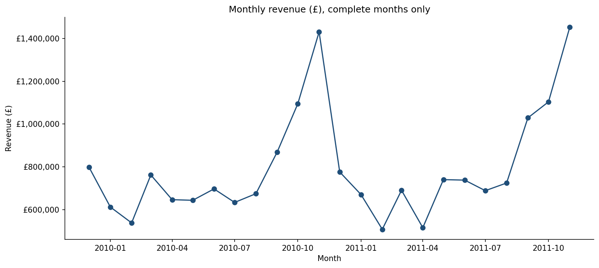
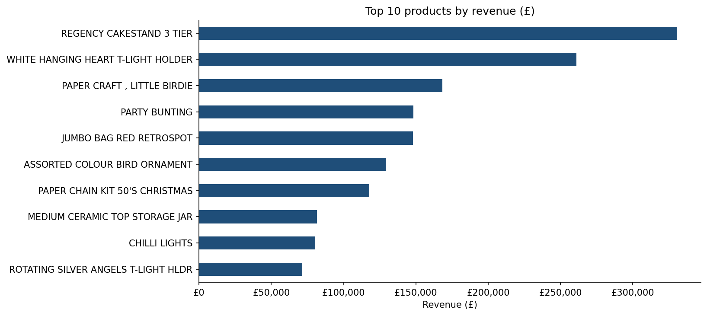
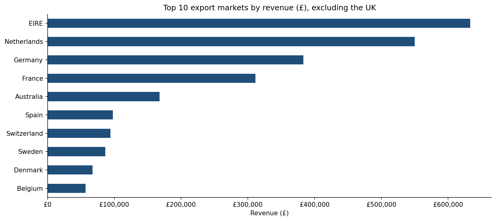
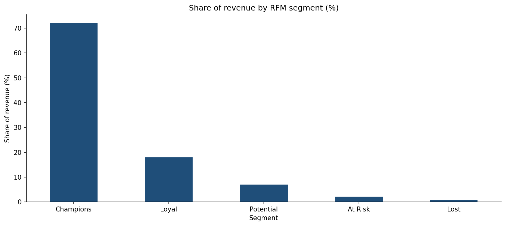

# UK Online Retail: Sales, Cancellations, Customer Segmentation and SAP-Aligned Data Model

A Python analysis of real transaction data from a UK-based online giftware retailer (December 2009 to December 2011). It covers data cleaning, sales analysis, cancellation analysis, RFM customer segmentation and a mapping of the cleaned data to an SAP SD billing structure. All monetary values are in pounds sterling (£).

> Personal portfolio project using a public dataset. No live SAP system was used.

## Headline Results
- Gross sales £19.41M; cancellations £0.47M (2.4% of gross); net revenue £18.94M.
- 376 of 2,443 cancelling customers (15.4%) account for 80% of cancelled value.
- Champions are 22.0% of identified customers and 73.0% of identified revenue.

## Dataset
UCI Machine Learning Repository, [Online Retail II](https://archive.ics.uci.edu/dataset/502/online+retail+ii) (transactions from 01 Dec 2009 to 09 Dec 2011): invoices, stock codes, descriptions, quantities, dates, unit prices (£), customer IDs and countries.

## Business Questions
1. How does monthly revenue change over time, and is there seasonality?
2. Which products and countries generate the most revenue?
3. How much value is lost to cancellations, and where is it concentrated?
4. How can customers be segmented by purchasing behaviour (RFM), and how concentrated is revenue?
5. How would this data look in an SAP SD billing structure?

## Method
1. **Audit:** missing values, duplicates, negative quantities and prices.
2. **Cleaning:** removed duplicates, non-product codes and invalid rows; separated cancellations; removed two extreme orders (see below).
3. **Analysis:** monthly trend, top products and markets, cancellation analysis.
4. **RFM segmentation:** Recency, Frequency and Monetary scores (quintiles) grouped into five segments.
5. **SAP-aligned model:** VBRK, VBRP, KNA1 and MAKT tables following SAP SD naming, with six integrity checks.

### Data Waterfall
| Step | Rows remaining | Rows removed |
|---|---|---|
| Raw rows | 1,067,371 | 0 |
| Exact duplicate rows removed | 1,033,036 | 34,335 |
| Non-product codes removed | 1,027,494 | 5,542 |
| Cancelled invoices separated | 1,009,573 | 17,921 |
| Invalid quantities or prices removed | 1,003,607 | 5,966 |
| Extreme reversed orders removed | 1,003,605 | 2 |

Two orders (74,215 units of one product in January 2011 and 80,995 units of another in December 2011; £245,653 in total) were each cancelled by the same customer 12 to 16 minutes after being placed. They were removed as likely entry errors.

## Key Findings
- 1,003,605 valid sales lines after cleaning; gross sales revenue was £19,411,634 across 39,521 invoices.
- Revenue peaked in November 2011 (£1,453,266); the lowest complete month was February 2011 (£508,015).
- Revenue for December 2010 to November 2011 was +1.7% compared with December 2009 to November 2010 (complete months only).
- The top 10 products generated 7.3% of revenue. The UK accounted for 85.3% of revenue; the largest export market was EIRE (£633,269).
- 13.3% of revenue came from transactions without a Customer ID and was excluded from segmentation.
- Across 5,853 identified customers, Champions made up 22.0% of customers and 73.0% of revenue. 965 customers were classed as At Risk, representing £369,546 of historical revenue. The top 20% of identified customers generated 76.9% of identified revenue.

## Cancellation Analysis
- **Definitions:** Gross = valid sales lines; Cancelled = lines on invoices starting with "C"; Net = Gross minus Cancelled.
- Gross £19,411,634 | Cancelled £471,063 (2.4% of gross) | Net £18,940,572. Cancelled invoices are 15.8% of all invoices but are much smaller in value than sales invoices.
- **Matching:** 91.3% of cancellation lines with a Customer ID were matched to an earlier sale of the same product by the same customer (approximate; quantity was not checked). £6,488 of cancelled value has no Customer ID and cannot be matched.
- **Timing:** median time to cancellation was 10 days (25% within 4 days, 75% within 30 days).
- **Concentration:** 376 of 2,443 cancelling customers (15.4%) account for 80% of cancelled value.
- **By segment** (cancelled value / segment sales): Loyal 3.8%, Potential 3.1%, At Risk 2.8%, Champions 2.5%, Lost 2.2%.
- **Monthly pattern:** the monthly cancellation rate ranged from 1.2% (May 2011) to 6.5% (April 2011).
  - April 2011 is driven by one bulk cancellation (invoice C550456, £22,998 of the month's £33,316), linked to two orders from January 2011. Excluding that invoice, April 2011 would be 2.0% and the overall cancellation rate 2.31% instead of 2.43%. It was kept because it is a genuine cancellation, not an entry error.
  - May 2010 (5.8%) is spread over 306 customers and 387 invoices, with three days accounting for 65% of the month's cancelled value. The cause was not identified.
- **Products:** among products with at least 10 cancelling customers and £5,000 of sales, the highest cancellation rates were the three Cherry Lights colour variants (29 to 36%; the largest single customer is only 4 to 12% of each product's cancelled value), Vintage Blue Kitchen Cabinet (25.5%), Cream Sweetheart Magazine Rack (19.5%) and Cooking Set Retrospot (17.6%). Other high-rate products (Two Door Curio Cabinet, Ivory Diner Wall Clock, Tea Time Party Bunting) are dominated by one customer (64 to 90% of cancelled value) and are not treated as product issues.
- A product with an 82% rate (Pantry Chopping Board) was excluded because 99.6% of its cancelled value came from one customer.

## Charts

## SAP-Aligned Data Model
The cleaned transactions were restructured into tables following SAP SD billing naming: VBRK (billing header), VBRP (billing items), KNA1 (customer master) and MAKT (material descriptions). Six integrity checks confirm that headers equal the sum of their items, totals match cleaned revenue, item keys are unique, and all items, materials and customers have matching header and master records. This is a structural mapping of public data, not an extract from SAP.

## Recommendations
1. Win-back campaign for At Risk customers.
2. Loyalty programme for Champions and Loyal customers.
3. Review the Cherry Lights colour variants and the Vintage kitchen cabinets (high cancellation rates spread across many customers) for variant, description or fulfilment issues. This is a hypothesis and has not been tested.
4. Capture customer IDs at checkout to improve segmentation.
5. Plan stock and staffing around the seasonal revenue peak.

## Limitations
- One retailer, December 2009 to December 2011; may not reflect current behaviour.
- The final month is incomplete and was excluded from trend calculations.
- Transactions without a Customer ID were excluded from RFM analysis.
- RFM thresholds follow a standard convention; Monetary is part of the score, so Champions' revenue share is partly by construction.
- Cancellations are matched to earlier sales approximately and may include order edits, not only returns.
- The monthly cancellation rate divides cancellations posted in a month by sales in that month.
- Two extreme orders were removed as likely entry errors; other bulk cancellations (e.g. invoice C550456) remain and can distort monthly rates.
- SAP tables are a structural mapping of public data, not an extract from SAP.

## How to Reproduce
1. Download the dataset from the UCI link above and save it as `online_retail_II.xlsx` in a Google Drive folder named `uk_retail_project`.
2. Open `UK_Online_Retail_Analysis.ipynb` in Google Colab, connect Google Drive and choose Runtime, then Restart session and run all.

## Tools
Python 3, pandas, NumPy, matplotlib, Google Colab

## Contact
[LinkedIn](https://www.linkedin.com/in/shirin-aghaei/)
